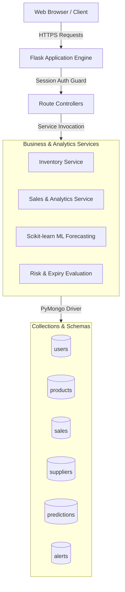
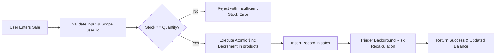

# Smart Inventory Intelligence & Food-Waste Prevention System

> **Inventory tracking, demand forecasting and food-waste prevention**

A full-stack, enterprise-ready inventory management and demand intelligence platform engineered to eliminate retail food spoilage and prevent costly stockouts. Powered by **Python**, **Flask**, **MongoDB / PyMongo**, **Scikit-learn**, **Pandas**, **Bootstrap 5**, and **Chart.js**.

---

## 1. Product Overview

In fast-paced food service operations, canteens, bakeries, and grocery retail, managing inventory requires balancing two competing risks: **stockouts** (lost revenue and dissatisfied customers) and **perishable spoilage** (food waste, lost capital, and ecological degradation).

**Smart Inventory Intelligence** unifies operational inventory tracking with machine-learning-driven sales forecasting and automated risk assessment algorithms. The platform empowers business operators to monitor stock levels, analyze sales velocity, forecast 7-day demand, receive actionable replenishment and clearance recommendations, and maintain strict multi-tenant data boundaries.

---

## 2. Problem Being Solved

- **Stockout Blind Spots**: In traditional retail, purchase orders are placed reactively only when shelves are empty. Without factoring in supplier delivery lead times and customer purchase velocity, businesses experience frequent supply bottlenecks.
- **Perishable Waste Accumulation**: Overstocking perishable products with imminent expiry dates leads to unavoidable waste when sales velocity is insufficient to clear stock in time.
- **Decentralized Data**: Lack of transactional visibility prevents managers from seeing top-selling items, revenue velocity across categories, and historical consumption patterns.
- **Tenant Isolation in SaaS**: Multi-tenant systems require rock-solid query scoping and compound indexing so that different businesses never leak data across account boundaries.

---

## 3. Main Features

- **Executive Analytics Dashboard**:
  - Real-time KPIs for total active products, current inventory stock valuation, cumulative revenue, and pending risk alerts.
  - Interactive Chart.js visualizations: 7-day sales revenue trends, category revenue breakdown, stock vs. forecasted demand, and real-time risk distribution matrix.
- **Product Catalog Management**:
  - Full CRUD operations with automatic sequential identifier generation (`PRD001`, `PRD002`, ...).
  - Track current stock, unit price, category, expiry dates, supplier associations, and reorder levels.
- **Atomic Sales Recording**:
  - Sales transactions atomically decrement available inventory using conditional MongoDB update operations (`$inc` guarded by `current_stock >= quantity_sold`), preventing negative inventory and overselling.
- **Machine Learning Demand Forecasting**:
  - Scikit-learn regression models trained on continuous sales histories (calendar day of week, day of month, weekend markers, lag-1 sales, and 7-day rolling averages).
  - Predicts aggregate 7-day demand and granular day-by-day projected consumption.
  - Enforces minimum 7 distinct calendar days requirement with fallback notifications when data is insufficient.
- **Risk Assessment & Food-Waste Prevention Engine**:
  - **Stockout Risk**: Evaluates lead-time demand (`(7-day demand / 7) * supplier lead time`) against on-hand stock to categorize risk as `HIGH`, `MEDIUM`, or `LOW`.
  - **Expiry / Waste Risk**: Calculates projected sales prior to expiry date. If expected unsold stock remains upon expiry, the system flags high waste risk.
  - **Prescriptive Recommendations**: Auto-generates actionable operational directives: `RESTOCK IMMEDIATELY`, `DISCOUNT & PROMOTION`, `MONITOR & PROMOTE`, `REDUCE PURCHASING`, and `OPTIMAL STOCK`.
- **Multi-Tenant SaaS Isolation**:
  - Session-based authentication with bcrypt-grade password hashing.
  - Strict tenant scoping (`user_id`) applied at the database query level across all entities.
- **User-Scoped Demo Data Generation**:
  - One-click dataset generator seeding realistic vendors, food products, and 45 days of sales records strictly scoped to the authenticated user.

---

## 4. Technology Stack

- **Application Backend**: Python 3.10+, Flask 3.0.3, Gunicorn 23.0.0
- **Database Engine**: MongoDB 6.0+ via PyMongo 4.6.3 (Native Aggregation Pipelines & Compound Indexes)
- **Machine Learning & Data Processing**: Scikit-learn 1.4.1, Pandas 2.2.1, NumPy 1.26.4
- **Security & Session**: Werkzeug Security (PBKDF2/SHA-256 password hashing), Flask Sessions
- **Frontend Architecture**: HTML5, Vanilla CSS, Bootstrap 5.3.3, Bootstrap Icons 1.11.3, Chart.js 4.4.1

---

## 5. Architecture and Data Flow



### Transaction & Sales Data Flow



---

## 6. MongoDB Collection Design

| Collection | Role | Primary Fields | Key Relationships |
|---|---|---|---|
| `users` | User accounts & credentials | `_id`, `name`, `email`, `password_hash`, `created_at` | Primary tenant identity (`user_id`). |
| `products` | Inventory catalog items | `product_id`, `name`, `category`, `current_stock`, `unit_price`, `reorder_level`, `expiry_date`, `supplier_id`, `unit`, `user_id` | Scoped by `user_id`; references `supplier_id`. |
| `sales` | Transaction history | `sale_id`, `product_id`, `product_name`, `category`, `date`, `quantity_sold`, `selling_price`, `total_amount`, `user_id` | Scoped by `user_id`; denormalizes product name and category for historical integrity. |
| `suppliers` | Vendor catalog & lead times | `supplier_id`, `name`, `contact_person`, `phone`, `email`, `lead_time_days` | Referenced by product records. |
| `predictions` | ML demand forecasts | `product_id`, `predicted_demand_7d`, `daily_forecast`, `model_used`, `confidence_note`, `updated_at`, `user_id` | Scoped by `(user_id, product_id)`. |
| `alerts` | Risk alerts & actions | `product_id`, `product_name`, `alert_type`, `risk_level`, `message`, `recommendation`, `created_at`, `user_id` | Scoped by `user_id`. |

---

## 7. MongoDB Aggregation Pipelines

All dashboard totals, sales KPIs, and trends are computed natively within the MongoDB database using optimized multi-stage aggregation pipelines:

### 1. Cumulative Sales Analytics Pipeline
```python
[
    {"$match": {"user_id": user_id}},
    {"$group": {
        "_id": None,
        "total_sales_count": {"$sum": 1},
        "total_items_sold": {"$sum": {"$ifNull": ["$quantity_sold", 0]}},
        "total_revenue": {"$sum": {"$ifNull": ["$total_amount", 0]}}
    }},
    {"$project": {
        "_id": 0,
        "total_sales_count": 1,
        "total_items_sold": 1,
        "total_revenue": {"$round": ["$total_revenue", 2]}
    }}
]
```

### 2. Category Distribution Pipeline
Groups sales by product category, sorts descending by gross revenue, and projects revenue rounded to 2 decimal places:
```python
[
    {"$match": {"user_id": user_id}},
    {"$group": {
        "_id": {"$ifNull": ["$category", "General"]},
        "revenue": {"$sum": {"$ifNull": ["$total_amount", 0]}},
        "quantity": {"$sum": {"$ifNull": ["$quantity_sold", 0]}}
    }},
    {"$sort": {"revenue": -1}},
    {"$project": {"_id": 0, "category": "$_id", "revenue": {"$round": ["$revenue", 2]}, "quantity": 1}}
]
```

### 3. Inventory Stock Valuation & Risk Aggregation
Aggregates total inventory valuation (`current_stock * unit_price`), counts items below reorder level, and converts expiry dates to compute items expiring within 3 days:
```python
[
    {"$match": {"user_id": user_id}},
    {"$addFields": {
        "_expiryDate": {"$dateFromString": {
            "dateString": {"$ifNull": ["$expiry_date", ""]},
            "onError": None,
            "onNull": None
        }}
    }},
    {"$group": {
        "_id": None,
        "total_products": {"$sum": 1},
        "total_stock_qty": {"$sum": {"$ifNull": ["$current_stock", 0]}},
        "total_inventory_value": {"$sum": {"$multiply": [
            {"$ifNull": ["$current_stock", 0]}, {"$ifNull": ["$unit_price", 0]}
        ]}},
        "low_stock_count": {"$sum": {"$cond": [
            {"$lte": [{"$ifNull": ["$current_stock", 0]}, {"$ifNull": ["$reorder_level", 10]}]}, 1, 0
        ]}},
        "near_expiry_count": {"$sum": {"$cond": [
            {"$ne": ["$_expiryDate", None]},
            {"$cond": [
                {"$lte": [{"$dateDiff": {"startDate": today, "endDate": "$_expiryDate", "unit": "day"}}, 3]},
                1, 0
            ]},
            0
        ]}}
    }}
]
```

---

## 8. Indexing and Schema Validation

### Compound Tenant-Aware Indexes
To guarantee optimal query performance and prevent multi-tenant index conflicts, the following compound indexes are established:

- `users`: `{ "email": 1 }` (unique)
- `products`: `{ "user_id": 1, "product_id": 1 }` (unique compound)
- `products`: `{ "user_id": 1, "category": 1 }`
- `sales`: `{ "user_id": 1, "sale_id": 1 }` (unique compound)
- `sales`: `{ "user_id": 1, "product_id": 1 }`
- `sales`: `{ "user_id": 1, "date": -1 }`
- `predictions`: `{ "user_id": 1, "product_id": 1 }` (unique compound)
- `alerts`: `{ "user_id": 1, "product_id": 1 }`
- `alerts`: `{ "user_id": 1, "risk_level": 1 }`
- `suppliers`: `{ "supplier_id": 1 }` (unique)

Initialize indexes safely:
```bash
python setup_db.py
```

### JSON Schema Validation
The system supports moderate MongoDB `$jsonSchema` validation for `users` and `products`. Enable validation by setting `MONGO_ENABLE_SCHEMA_VALIDATION=true` in production.

---

## 9. Authentication and Data Isolation

- **Session Security**: Session tokens are signed via server-side `SECRET_KEY` with HTTP-only cookies.
- **Password Protection**: Passwords are never stored in plaintext; they are hashed using Werkzeug's PBKDF2/SHA-256 implementation.
- **Direct Object Reference (IDOR) Mitigation**: Every query and mutation enforces the authenticated user's ID:
  ```python
  db.products.find_one({"product_id": product_id, "user_id": current_user["user_id"]})
  ```
- **Demo Seed Scoping**: Demo data generation explicitly tags newly seeded records with the calling user's account ID, leaving other tenant databases completely unaffected.

---

## 10. Demand Forecasting Approach

1. **Daily Aggregation**: Raw sale records are grouped by date to construct continuous daily sales time-series per product.
2. **Feature Engineering**:
   - `day_of_week`: Captures cyclical weekly variation (e.g. weekend spikes).
   - `day_of_month`: Captures monthly purchasing patterns.
   - `is_weekend`: Binary flag for Saturday and Sunday behavior.
   - `lag_1`: Sales volume from previous day.
   - `rolling_7d`: Moving average over the preceding week.
3. **Model Selection**: Scikit-learn `LinearRegression` model fits the feature matrix.
4. **Validation Guard**: Requires a minimum of 7 distinct calendar dates of sales. If fewer than 7 days exist, the model returns an explicit fallback with zero projection rather than guessing wildly.

---

## 11. Local Setup Instructions

### Prerequisites
- Python 3.10 or higher
- MongoDB Community Server running locally on port 27017 (or MongoDB Atlas connection string)
- Git

### Installation Steps

1. **Clone the Repository**:
   ```bash
   git clone https://github.com/Deepnarayan70/smart-inventory-intelligence.git
   cd smart-inventory-intelligence
   ```

2. **Create and Activate Virtual Environment**:
   ```bash
   # Windows PowerShell
   python -m venv venv
   .\venv\Scripts\Activate.ps1

   # Linux / macOS
   python3 -m venv venv
   source venv/bin/activate
   ```

3. **Install Dependencies**:
   ```bash
   pip install -r requirements.txt
   ```

4. **Configure Environment Variables**:
   Create a `.env` file in the project root:
   ```env
   MONGO_URI=mongodb://localhost:27017/inventory_db
   SECRET_KEY=change-this-to-a-very-strong-secret-key-32-chars
   PORT=5000
   ```

5. **Initialize Database Indexes**:
   ```bash
   python setup_db.py
   ```

---

## 12. Environment Variables

| Variable | Description | Default | Production Note |
|---|---|---|---|
| `MONGO_URI` | MongoDB connection string | `mongodb://localhost:27017/inventory_db` | Use MongoDB Atlas URI with credentials |
| `SECRET_KEY` | Flask session secret key | `super-secret-key-smart-inventory-prod` | Must be a cryptographically secure random string |
| `PORT` | Web server port | `5000` | Typically provided by hosting environment |
| `AUTO_INIT_DB_INDEXES` | Auto-verify indexes on startup | `true` | Set to `false` if managed via CI/CD |
| `MONGO_ENABLE_SCHEMA_VALIDATION`| Enable MongoDB JSON schema validation | `false` | Enable once historical documents conform |

---

## 13. How to Run the Application

### Development Server
```bash
python run.py
```
Access the application at `http://127.0.0.1:5000`.

### Production WSGI Server (Gunicorn)
```bash
gunicorn run:app --bind 0.0.0.0:5000 --workers 2 --threads 4
```

---

## 14. How to Run Tests

The automated integration verification suite runs against an isolated, randomly generated test database (`inventory_test_...`) and automatically cleans up upon completion.

```bash
python test_suite.py
```

### Verified Test Matrix
1. User registration, login, logout, and protected route redirection.
2. Clean empty dashboard for new registrations.
3. Complete product CRUD operations.
4. Sales transactions with atomic stock decrement.
5. Stock replenishment workflows.
6. Demand forecasting with insufficient history fallback (< 7 days) and linear regression (>= 7 days).
7. Stockout risk and expiry/waste risk assessment calculations.
8. Strict multi-user data isolation.
9. User-scoped demo dataset seeding without cross-tenant leakage.
10. Native MongoDB aggregation pipelines (totals, categories, trends, top products).
11. Compound index creation and structure verification.
12. Input validation and overselling concurrency guards.
13. Frontend UI routing and HTTP 200 response checks across all views.
14. Application factory startup and database ping lifecycle.

---

## 15. Deployment Instructions

### Render Deployment
This project includes a production-ready `render.yaml` blueprint.

1. Push your repository to GitHub.
2. In the Render Dashboard, create a new **Web Service** connected to your repository.
3. Configure the service settings:
   - **Environment**: `Python`
   - **Build Command**: `pip install -r requirements.txt`
   - **Start Command**: `gunicorn run:app`
4. Set Environment Variables in Render:
   - `MONGO_URI`: `mongodb+srv://<username>:<password>@cluster.mongodb.net/inventory_db?retryWrites=true&w=majority`
   - `SECRET_KEY`: `<generate-a-strong-secret-key>`
   - `PYTHON_VERSION`: `3.10.12`

---

## 16. Known Limitations

- **Cross-Collection Multi-Document Transactions**: In standalone MongoDB deployments, multi-document atomic transactions across `products` and `sales` require replica set mode. The application provides compensating rollback logic when running on standalone nodes.
- **Cold Start Forecasts**: Machine learning predictions require a minimum of 7 distinct calendar days of sales transactions per product before activating linear regression models.
- **Real-Time WebSockets**: Dashboard metrics update on page refresh or navigation; real-time push via WebSockets is slated for a future release.
