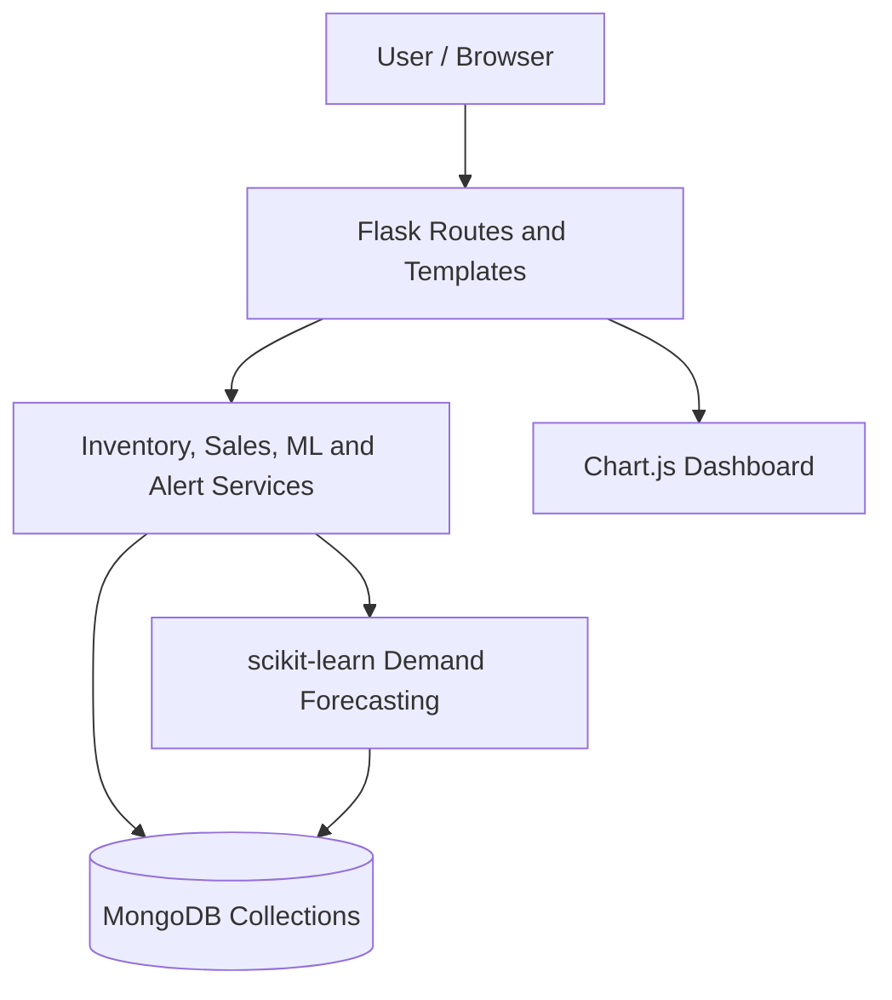
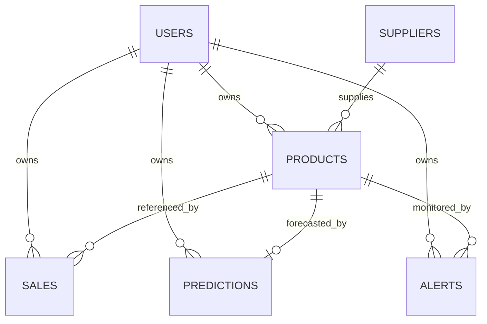
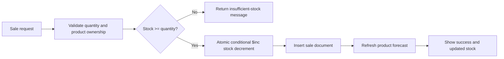

# Architecture Diagrams

## System architecture

## Document relationships

These diagrams describe relationships implemented or implied by the source code; they are not an ER-enforced relational schema.

## Sale data flow

